# MILESTONE_REGISTER.md — Research Roadmap & Milestone Register

> **Document Status:** Active Execution Roadmap  
> **Source Documents:** [incoming/01_research_project_understanding.md](incoming/01_research_project_understanding.md) (§10), [incoming/02_independent_scientific_audit.md](incoming/02_independent_scientific_audit.md) (§11, §14)  
> **Governance Rule:** Milestone transitions require meeting explicit acceptance criteria. No model training may occur before Gate 0 (M0 & M1) is passed.

---

## 1. Roadmap Overview & Phased Architecture

```mermaid
flowchart LR
    subgraph Gate0["Phase 0: Feasibility & Alignment"]
        M0["M0: Read-Only Data Audit<br/>(P0)"]
        M1["M1: Supervisor Checkpoint<br/>(P0)"]
    end

    subgraph Phase1["Phase 1: Rigor & Confounding"]
        M2["M2: Curation & Molecular Join<br/>(P1)"]
        M3["M3: Nested Grouped CV Pipeline<br/>(P1)"]
        M4["M4: Confounding Experiments<br/>(P1)"]
    end

    subgraph Phase2["Phase 2: Within-Type & External"]
        M5["M5: Within-Type Grading<br/>(P1)"]
        M6["M6: Locked CGGA Validation (Proposed)<br/>(P1)"]
    end

    subgraph Phase3["Phase 3: Synthesis & Publication"]
        M7["M7: Survival & Biomarkers (Conditional)<br/>(P2)"]
        M8["M8: Manuscript & Code Release<br/>(P2)"]
    end

    M0 --> M1
    M1 --> M2
    M2 --> M3
    M3 --> M4
    M4 --> M5
    M5 --> M6
    M6 --> M7
    M7 --> M8
```

---

## 2. Detailed Milestone Specifications

### Milestone M0: Read-Only Data & Label Feasibility Audit
- **Priority:** **P0 (Critical Pre-Execution Gate)**
- **Status:** **PENDING / IMMEDIATE ACTION**
- **Objective:** Run a non-invasive Python audit script on the raw Google Drive data to verify sample identity, scale, and clinical completeness without altering any data.
- **Specific Tasks:**
  1. Inspect file headers and sample value ranges of `star_tpm` to verify whether expression data is raw TPM or `log2(TPM + 1)` (W11).
  2. Parse TCGA sample barcodes: extract 12-character patient identifiers (`bcr_patient_barcode`) to count unique biological patients (W4).
  3. Audit sample type codes: tally primary solid tumors (`-01`), recurrent tumors (`-02`), and normal solid tissues (`-11`) (W5).
  4. Generate full cross-tabulation of `primary_diagnosis` $\times$ `tumor_grade` $\times$ TCGA project (`TCGA-LGG` vs `TCGA-GBM`).
  5. Audit survival fields: determine total events and completeness for Overall Survival (`OS`, `OS.time`) and Progression-Free Interval (`PFI`, `PFI.time`).
  6. Attempt to locate the source code or notebook yielding the Phase-I reported 84.51% RF accuracy (W12).
- **Deliverables:** `AUDIT_REPORT_M0.md` detailing exact patient counts, sample breakdowns, expression scale verification, and survival statistics.
- **Exit Criteria:** Unambiguous confirmation of unique patient count, scale, and sample types.

---

### Milestone M1: Supervisor Checkpoint & Pre-Registered Protocol
- **Priority:** **P0 (Critical Governance Gate)**
- **Status:** **PENDING M0 OUTPUTS**
- **Objective:** Formalize project scope, paper framing, and analysis plan with the research supervisor based on M0 audit findings.
- **Specific Tasks:**
  1. Present M0 audit results and the four foundational decision conflicts (CONF-01 to CONF-04) to the supervisor.
  2. Secure formal sign-off on:
     - Target label definition (historical baseline vs. WHO CNS5-approximate primary).
     - Pruning candidate objectives: evaluate proposed Option A (Confounding) + Option B (Within-Type) + Option C (Survival) framing.
     - Scope of normal brain transcriptomes (relegated to supplementary sanity check).
     - Resolution of Phase-I 84.51% discrepancy (retract or replace with verified baseline).
  3. Author and freeze a pre-registered statistical analysis plan (`ANALYSIS_PLAN.md`) using [docs/templates/ANALYSIS_PLAN_TEMPLATE.md](docs/templates/ANALYSIS_PLAN_TEMPLATE.md), specifying primary endpoints, metrics, models, and CGGA validation rules before executing model training.
- **Deliverables:** Signed/logged supervisor decisions in [DECISION_LOG.md](DECISION_LOG.md); frozen `ANALYSIS_PLAN.md`.
- **Exit Criteria:** Unambiguous supervisor approval of project blueprint and analysis plan.

---

### Milestone M2: Data Curation, Filtering & Molecular Annotation Join
- **Priority:** **P1 (Core Methodological Fix)**
- **Status:** **NOT STARTED (Blocked by M1)**
- **Objective:** Establish a clean, deduplicated, molecularly annotated master dataset.
- **Specific Tasks:**
  1. Filter raw TCGA data to primary untreated solid tumors (`sample_type == '01'`) only.
  2. Deduplicate to exactly one tumor aliquot per unique patient barcode.
  3. Join external molecular annotations from Ceccarelli et al. (2016) / NCI GDC tables (IDH mutation status, 1p/19q codeletion, *CDKN2A/B* copy number alterations).
  4. Construct dual-label targets: Historical WHO 2007/2016 Grade and WHO CNS5-approximate molecular grades.
  5. Isolate NOS and Mixed glioma cases into a designated sensitivity cohort.
- **Deliverables:** Cleaned, versioned parquet/feather data splits with comprehensive metadata logs.
- **Exit Criteria:** Master cohort verified with 0 duplicate patients, 0 non-primary tissues, and matched molecular annotations.

---

### Milestone M3: Leakage-Free Nested Grouped Cross-Validation Pipeline
- **Priority:** **P1 (Core Methodological Fix)**
- **Status:** **NOT STARTED (Blocked by M2)**
- **Objective:** Build an end-to-end, leakage-free evaluation harness supporting patient-grouped nested cross-validation.
- **Specific Tasks:**
  1. Implement $5 \times 5$ outer/inner patient-grouped, stratified cross-validation using `GroupKFold` / `StratifiedGroupKFold`.
  2. Encapsulate all feature transformations strictly inside training folds:
     - All-zero and low-expression filtering.
     - In-fold variance thresholding or Elastic-Net sparse feature selection.
     - Class imbalance handling (evaluate class-weighted loss vs in-fold SMOTE).
  3. Implement standardized model interfaces for benchmark suite: Elastic-Net Logistic Regression, Random Forest, XGBoost, Support Vector Machine (RBF kernel).
  4. Integrate evaluation harness reporting Balanced Accuracy, Macro-F1, MCC, per-class recall, AUROC, and 95% bootstrap confidence intervals ($B \ge 1,000$).
- **Deliverables:** Fully unit-tested, modular pipeline scripts in `src/`.
- **Exit Criteria:** Demonstration of 0 leakage across outer test folds confirmed via synthetic canary features.

---

### Milestone M4: Confounding & Cohort Effect Quantification Experiments
- **Priority:** **P1 (Core Scientific Contribution)**
- **Status:** **NOT STARTED (Blocked by M3)**
- **Objective:** Quantify the magnitude and contribution of cohort and molecular differences to Grade IV prediction.
- **Specific Tasks:**
  1. Evaluate historical Grade II vs III vs IV classification under the nested CV harness to establish a clean, leakage-free historical baseline.
  2. Execute Confounding Experiment 1: Train classifier to predict source cohort (`TCGA-LGG` vs `TCGA-GBM`) strictly within an IDH-matched tumor subset.
  3. Execute Confounding Experiment 2: Perform unsupervised clustering / UMAP on IDH-wildtype LGG Grade II/III cases to test whether they cluster with GBM.
  4. Execute Confounding Experiment 3: Evaluate a simple IDH-only classifier against Grade IV ground truth.
  5. Execute Confounding Experiment 4: Re-evaluate Grade IV discrimination before and after regressing out IDH transcriptional variance.
- **Deliverables:** Comprehensive empirical confounding evaluation report (`CONFOUNDING_ANALYSIS.md`) with publication-ready figures.
- **Exit Criteria:** Rigorous quantification of how much Grade IV classification performance stems from cohort/IDH differences vs true grade biology.

---

### Milestone M5: Within-Type Transcriptomic Grading (Core Task)
- **Priority:** **P1 (Core Scientific Contribution)**
- **Status:** **NOT STARTED (Blocked by M4)**
- **Objective:** Evaluate transcriptomic Grade II vs Grade III discrimination within homogeneous WHO CNS5 molecular types.
- **Specific Tasks:**
  1. Partition dataset into biologically defined cohorts:
     - Cohort B1: Astrocytoma, IDH-mutant (Grade 2 vs Grade 3/4).
     - Cohort B2: Oligodendroglioma, IDH-mutant and 1p/19q-codeleted (Grade 2 vs Grade 3).
  2. Train and evaluate benchmark classifiers (Elastic-Net, RF, XGB, SVM) under patient-grouped nested cross-validation.
  3. Benchmark against clinical/demographic baseline (Patient Age + Karnofsky Performance Score alone).
  4. Compute out-of-fold SHAP values; assess feature ranking stability across outer CV folds; map top Ensembl IDs to HGNC symbols.
- **Deliverables:** Within-type performance tables, ROC/PR curves, and stable gene candidate signatures.
- **Exit Criteria:** Reliable determination of whether transcriptomic Grade II vs III discrimination exceeds chance and clinical baselines within molecular types.

---

### Milestone M6: CGGA Acquisition, Harmonization & Locked External Validation (Proposed)
- **Priority:** **P1 (Proposed External Validation)**
- **Status:** **NOT STARTED (Blocked by M5)**
- **Objective:** Validate the TCGA-trained within-type grading models on the independent Chinese Glioma Genome Atlas (CGGA) cohorts, subject to data accessibility and suitability verification.
- **Specific Tasks:**
  1. Ingest CGGA `mRNAseq_693` and `mRNAseq_325` datasets.
  2. Filter strictly to primary untreated gliomas (`02_audit` §7, D2).
  3. Harmonize gene identifiers, sequencing scales, and batch distributions using training-set-fitted transformations only.
  4. Lock the final TCGA-trained classifiers; execute a single evaluation run on the primary CGGA cohort with zero parameter tuning or threshold adjustments.
  5. Evaluate domain shift impact and report external Balanced Accuracy, Macro-F1, MCC, and AUROC with bootstrap CIs.
- **Deliverables:** External validation report (`EXTERNAL_VALIDATION_CGGA.md`) documenting locked model generalizability.
- **Exit Criteria:** Unbiased, locked-model external validation metrics recorded for the primary manuscript.

---

### Milestone M7: Survival Analysis & Gene Signature Biological Annotation (Conditional)
- **Priority:** **P2 (Conditional on Data Feasibility)**
- **Status:** **NOT STARTED (Blocked by M6)**
- **Objective:** Test independent prognostic value of transcriptomic risk and annotate biological pathways (strictly conditional on survival event counts and follow-up data quality).
- **Specific Tasks:**
  1. Extract predicted risk scores / probability outputs from within-type grading models.
  2. Fit multivariable Cox Proportional Hazards models adjusting for age, IDH mutation status, 1p/19q status, and assigned grade (`02_audit` §8, §9.1).
  3. Verify proportional hazards assumptions (Schoenfeld residuals); report hazard ratios (HR), 95% CIs, and Harrell's C-index improvement.
  4. Validate survival risk stratification externally in CGGA survival cohorts.
  5. Conduct Over-Representation Analysis (ORA) and Gene Set Enrichment Analysis (GSEA) on stable grading genes using MSigDB Hallmark and GO Biological Process gene sets.
- **Deliverables:** Multivariable Cox regression tables, Kaplan-Meier survival curves, and pathway enrichment bubble plots.
- **Exit Criteria:** Confirmation of whether transcriptomic risk provides independent prognostic utility beyond known clinical covariates.

---

### Milestone M8: Manuscript Preparation & Reproducibility Release
- **Priority:** **P2 (Publication & Dissemination)**
- **Status:** **NOT STARTED (Blocked by M7)**
- **Objective:** Author publication-grade manuscript following TRIPOD+AI guidelines and release a fully reproducible research repository.
- **Specific Tasks:**
  1. Draft manuscript adhering to targeted Q1 journal formatting and TRIPOD+AI reporting checklist.
  2. Finalize high-resolution vector figures (study flowchart, confounding diagnostics, within-type ROC curves, CGGA validation, KM plots).
  3. Package clean, documented codebase with pinned environment specifications (`pyproject.toml`, conda `environment.yml`) and containerized execution instructions.
  4. Perform final internal audit ensuring every claim, metric, and citation matches repository registers.
- **Deliverables:** Complete manuscript submission package, supplementary materials, and public GitHub/Zenodo repository archive.
- **Exit Criteria:** Final supervisor sign-off and journal submission.

---

## 3. Milestone Summary & Status Board

| Milestone ID | Title | Priority | Pre-requisites | Primary Deliverable | Current Status |
|---|---|---|---|---|---|
| **M0** | Read-Only Data & Label Feasibility Audit | **P0** | Google Drive access | `AUDIT_REPORT_M0.md` | **PENDING / IMMEDIATE** |
| **M1** | Supervisor Checkpoint & Pre-Registration | **P0** | M0 | `ANALYSIS_PLAN.md`, `DECISION_LOG.md` | **BLOCKED (M0)** |
| **M2** | Data Curation & Molecular Annotation Join | **P1** | M1 | Curated Parquet Datasets | **NOT STARTED** |
| **M3** | Leakage-Free Nested Grouped CV Pipeline | **P1** | M2 | Modular CV Framework (`src/`) | **NOT STARTED** |
| **M4** | Confounding & Cohort Effect Experiments | **P1** | M3 | `CONFOUNDING_ANALYSIS.md` | **NOT STARTED** |
| **M5** | Within-Type Transcriptomic Grading | **P1** | M4 | Within-Type Grading Benchmark | **NOT STARTED** |
| **M6** | Locked CGGA External Validation | **P1 (Proposed)** | M5 | `EXTERNAL_VALIDATION_CGGA.md` | **NOT STARTED** |
| **M7** | Survival Analysis & Pathway Annotation | **P2 (Conditional)** | M6 | Multivariable Cox & GSEA Reports | **NOT STARTED** |
| **M8** | Manuscript Preparation & Code Release | **P2** | M7 | TRIPOD+AI Submission Package | **NOT STARTED** |
