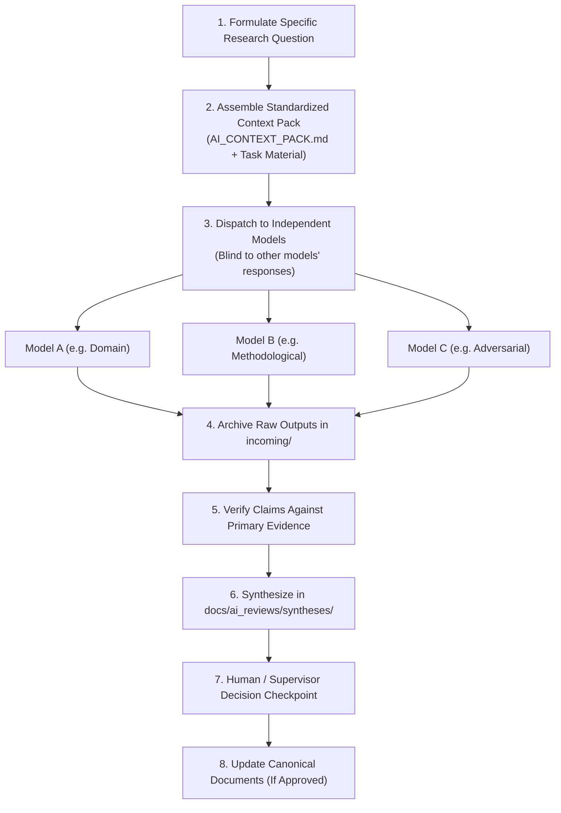

# MULTI_MODEL_REVIEW_PROTOCOL.md — Multi-Model AI Collaboration & Review Protocol

> **Document Status:** Active Research Governance Protocol  
> **Applicability:** All multi-model AI evaluation workflows, human researchers, and automated synthesis agents.  
> **Primary Authority:** The canonical GitHub repository (`glioma-fyp-research-hub`) remains the sole official source of truth.

---

## 1. Principles of Multi-Model AI Collaboration

This research project leverages multiple frontier AI models across diverse providers (e.g., via T3 Chat, ChatGPT, Claude, Gemini, and compatible platforms) to independently examine specific scientific, statistical, and methodological aspects of the research.

### Core Governance Principles:
1. **Advisory Role Only:** External AI models function strictly as independent research assistants, critical reviewers, and intellectual stress-testers. They are **not** independent sources of scientific authority.
2. **Canonical Source of Truth:** All models must operate from an identical, version-controlled representation of the latest project context (`AI_CONTEXT_PACK.md` pinned to a specific Git commit SHA). The central GitHub repository remains the sole source of truth.
3. **No Automatic Authority from Consensus:** Scientific claims do **not** become verified facts merely because multiple AI models agree. Agreement may simply reflect shared training biases or common literature heuristics.
4. **Disagreement as an Investigational Signal:** When models disagree, the discrepancy must trigger primary investigation against raw data, code, or peer-reviewed literature, rather than automatic dismissal.
5. **Human & Supervisor Prerogative:** Model outputs must be evaluated by human researchers and approved by the project supervisor before any recommendation is incorporated into canonical documents.

---

## 2. Independent Review Perspectives & Roles

Rather than binding specific AI providers or architectures to fixed tasks, the protocol defines five modular review perspectives. A human researcher may assign any capable model to any perspective:

### Role 1: Domain & Scientific Reviewer
- **Primary Focus:** Biological plausibility, oncological taxonomy, and clinical relevance.
- **Specific Tasks:**
  - Evaluates whether the research question aligns with modern neuro-oncological standards (e.g., WHO CNS5 criteria).
  - Scrutinizes biological assumptions regarding tumor heterogeneity, molecular subtypes, and clinical grade definitions.
  - Checks whether proposed transcriptomic markers or risk signatures have established biological mechanisms.
  - Flags clinical overclaiming (e.g., confusing prognostic correlation with diagnostic utility).

### Role 2: Statistical & Methodological Reviewer
- **Primary Focus:** Mathematical rigor, experimental design, leakage control, and uncertainty estimation.
- **Specific Tasks:**
  - Evaluates cross-validation partitioning, patient-level grouping, and leakage-free feature selection.
  - Assesses handling of high-dimensional tabular data ($P \gg N$) and class imbalance techniques (SMOTE vs. cost-sensitive weighting).
  - Checks statistical assumptions for multivariable survival models (proportional hazards, covariate collinearity).
  - Evaluates metric selection (advocating Balanced Accuracy, Macro-F1, MCC over naive accuracy).
  - Checks adequacy of bootstrap resampling ($B \ge 1,000$) and confidence interval reporting.

### Role 3: Literature & Evidence Reviewer
- **Primary Focus:** Bibliographic hygiene, research gap validity, and prior art benchmarking.
- **Specific Tasks:**
  - Investigates whether claimed research gaps or novelties are genuine against recent literature (2021–2026).
  - Verifies citations (authors, year, journal, DOI) against primary databases (PubMed, CrossRef).
  - Identifies competing models, conflicting findings, or parallel studies on TCGA and CGGA.
  - Evaluates whether comparators are drawn from identical modalities (e.g., preventing MRI studies from being cited as RNA-seq baselines).

### Role 4: Adversarial Research Reviewer ("Reviewer 2")
- **Primary Focus:** Skeptical peer review, vulnerability discovery, and failure-mode analysis.
- **Specific Tasks:**
  - Acts as a demanding, skeptical journal reviewer seeking justification for paper rejection.
  - Probes for hidden confounds, circular logic, batch effects, and unexamined alternative hypotheses.
  - Challenges unsupported causal language or premature translational claims.
  - Pinpoints reasons why the study might fail external replication or fail peer review at a Q1 journal.

### Role 5: Research Synthesis Reviewer
- **Primary Focus:** Structured comparison, cross-model reconciliation, and decision drafting.
- **Specific Tasks:**
  - Ingests multiple independent model evaluations addressing the same research question.
  - Identifies areas of genuine consensus vs. superficial heuristic agreement.
  - Highlights material disagreements and maps them back to empirical questions.
  - Prepares structured synthesis reports (`docs/templates/AI_REVIEW_SYNTHESIS_TEMPLATE.md`) for human review.

---

## 3. Independent Review Execution Procedure

For any non-trivial research decision, methodology change, or audit task, follow this 10-step protocol:

### The 10 Steps:
1. **Formulate One Clear Question:** Define a single, bounded research question or task (e.g., "Evaluate the suitability of Hu et al. predicted 1p/19q in CGGA as an external validation endpoint").
2. **Standardize the Prompt & Context:** Provide identical copies of `AI_CONTEXT_PACK.md` and any required task-specific source files to each participating model.
3. **Use the Standardized Prompt:** Deploy [MULTI_MODEL_REVIEW_PROMPT.md](MULTI_MODEL_REVIEW_PROMPT.md) with explicit role and depth instructions.
4. **Maintain Independence (Blind Reviewing):** Ensure each model generates its evaluation independently without seeing the outputs of other models.
5. **Preserve Complete Outputs:** Save raw, unaltered model outputs in [docs/ai_reviews/incoming/](docs/ai_reviews/incoming/) using the [docs/templates/AI_REVIEW_RECORD_TEMPLATE.md](docs/templates/AI_REVIEW_RECORD_TEMPLATE.md) structure.
6. **Cross-Model Comparison:** Identify common agreements, divergent conclusions, and unique insights.
7. **Source-Level Verification:** Audit all citations and empirical claims made by models against actual repository data and PubMed/CrossRef.
8. **Draft a Synthesis Report:** Prepare a synthesis report using [docs/templates/AI_REVIEW_SYNTHESIS_TEMPLATE.md](docs/templates/AI_REVIEW_SYNTHESIS_TEMPLATE.md) and archive it in [docs/ai_reviews/syntheses/](docs/ai_reviews/syntheses/).
9. **Supervisor / Human Review:** Review the synthesis at a project decision checkpoint.
10. **Canonical Documentation Update:** If and only if a recommendation is approved by the human supervisor, update the relevant canonical repository files (`CURRENT_STATE.md`, `RESEARCH_BLUEPRINT.md`, `DECISION_LOG.md`).

---

## 4. Scientific Evidence Hierarchy

To prevent AI hallucination or collective model bias from compromising the research, all project contributors must enforce this evidence hierarchy:

| Level | Evidence Source | Epistemic Weight | Role in Decision-Making |
|---|---|---|---|
| **Tier 1** | **Directly Inspected Research Data & Executed Code** | Ground Truth | Primary empirical foundation. Rebuts all model arguments. |
| **Tier 2** | **Peer-Reviewed Primary Literature & Consortia Specs** | High Authority | Establishes clinical/biological ground truth (e.g., WHO CNS5, TCGA/CGGA publications). |
| **Tier 3** | **Verified Methodological & Statistical Standards** | High Authority | Enforces best practices (e.g., TRIPOD+AI, nested CV principles). |
| **Tier 4** | **Human Expert & Research Supervisor Directives** | Decisional Authority | Governs project scope, milestone gates, and submission strategies. |
| **Tier 5** | **Independent AI Model Reviews & Syntheses** | Advisory Only | Heuristic leads, vulnerability checks, and critical perspectives requiring verification. |

> [!IMPORTANT]
> A claim made by three frontier AI models that contradicts Tier 1 data or Tier 2 primary literature is **false**, regardless of the confidence expressed by the models.

---

## 5. Data Privacy & External Platform Security

When interacting with external AI platforms (T3 Chat, OpenAI, Anthropic, Google AI Studio, etc.):

### Strict Upload Prohibitions:
- **NO Raw Genomic Matrices:** Never upload full expression matrices (`star_tpm`), raw counts, or VCF files.
- **NO Patient-Level Clinical Records:** Never upload raw clinical TSVs containing unaggregated demographic, clinical, or survival rows.
- **NO Authentication Tokens or Keys:** Never upload credentials, API keys, SSH keys, or access tokens.
- **NO Restricted-Access Data:** Never upload datasets subject to Data Use Agreements (DUAs) prohibiting third-party server ingestion.

### Permitted Research Materials:
- Version-controlled Markdown documentation (`AI_CONTEXT_PACK.md`, blueprints, decision logs).
- Sanitized, aggregated summary tables (e.g., cohort cross-tabulations, class count tables).
- Methodological scripts and code snippets stripped of hardcoded credentials or private paths.

Always verify the data retention, training, and privacy settings of each AI platform prior to uploading research documents.
