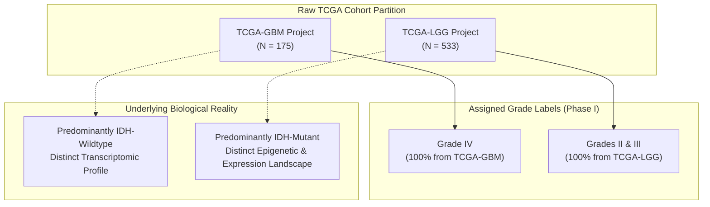
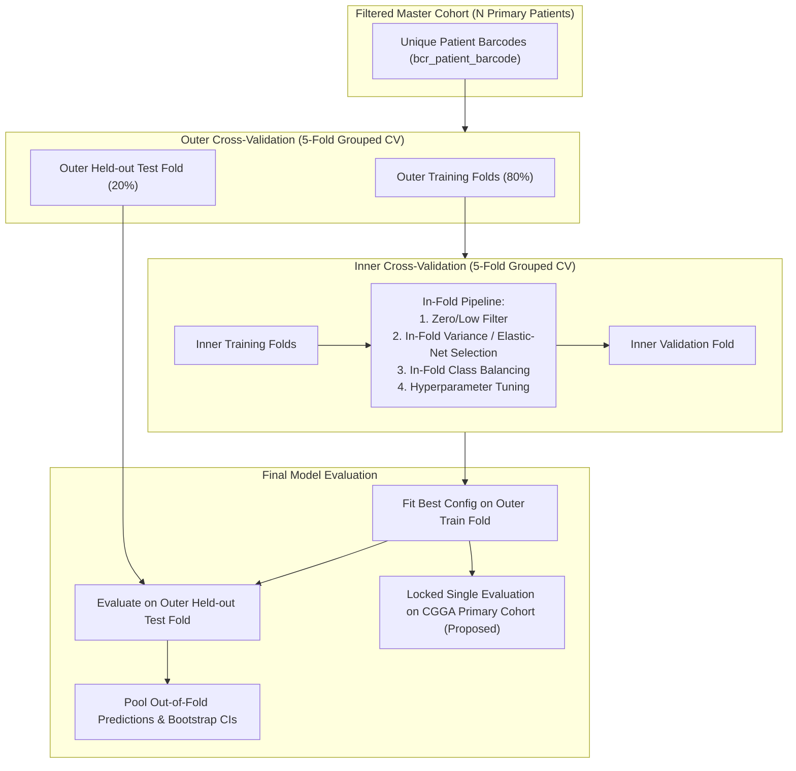

# RESEARCH_BLUEPRINT.md — Scientific Blueprint & Proposed Study Architecture

> **Document Status:** Architectural Proposal (PROPOSED — Pending Supervisor Approval)  
> **Source Documents:** [incoming/01_research_project_understanding.md](incoming/01_research_project_understanding.md), [incoming/02_independent_scientific_audit.md](incoming/02_independent_scientific_audit.md)  
> **Target Alignment:** Q1 Medical Informatics / Computational Oncology Journal (Proposed Target)  

---

## 1. Problem Definition, Motivation & Scientific Gap

### 1.1 The Clinical Problem
Adult-type diffuse gliomas represent the most prevalent and aggressive primary malignant brain tumors. Historically, clinical management and prognostic stratification relied on histological grading (WHO Grades II, III, and IV). However:
- **Histological Ambiguity (Grade II vs. III):** Differentiating Grade II from Grade III gliomas based on histological criteria (mitotic figures, cellular density, Ki-67 proliferation index) suffers from marked interobserver variability (`02_audit` §4, S1, S3, S4, S10).
- **Clinical Need for Reproducibility:** A molecular, transcriptomic readout capable of providing objective grading assistance would theoretically resolve histological discordance.

### 1.2 The Paradigm Shift: WHO CNS5 (2021)
The publication of the 5th Edition of the WHO Classification of Tumors of the Central Nervous System (WHO CNS5) revolutionized neuro-oncology (`02_audit` §5.1, S1–S4):
1. **Grading Within Molecular Type:** Grading is no longer evaluated across a single morphological continuum. Instead, gliomas are stratified by definitive molecular markers:
   - *Astrocytoma, IDH-mutant* (Grades 2, 3, or 4). Crucially, the presence of homozygous deletion of *CDKN2A/B* automatically confers Grade 4 status, even in tumors appearing histologically low-grade.
   - *Oligodendroglioma, IDH-mutant and 1p/19q-codeleted* (Grades 2 or 3).
   - *Glioblastoma, IDH-wildtype* (Grade 4 only). An IDH-wildtype diffuse astrocytic glioma demonstrating *TERT* promoter mutation, *EGFR* gene amplification, or combined $+7/−10$ chromosome copy number alterations is classified as Glioblastoma, WHO Grade 4.
2. **Obsolete Terminology:** Terms such as "anaplastic astrocytoma" and "anaplastic oligodendroglioma" are formally retired.
3. **Scientific Implication:** Evaluating machine learning models on a pooled, unstratified Grade II vs III vs IV target derived from 2007/2016 histological diagnosis strings constitutes an obsolete study design.

### 1.3 Literature & Modality-Specific Context
The independent scientific audit identified key literature comparators, noting distinct modality boundaries:
- A systematic review of 85 machine learning studies predicting glioma grades (`02_audit` §5.1, S7) reported mean accuracy of $0.89 \pm 0.09$, but the vast majority evaluated **MRI radiomics**, not RNA-seq. Only 5 of 85 studies (5.9%) performed external validation (dropping to 0.82), and mean TRIPOD adherence was low (44.5%). These imaging figures must not be generalized to transcriptomics.
- A multimodal study combining pathology images with molecular data (`02_audit` §5.1, S9) reported $73.95\% \pm 3.73\%$ accuracy for LGG Grade II vs III in TCGA. This reflects an image-and-molecular context and must not be treated as a universal accuracy ceiling for pure RNA-seq grading.
- Previous RNA-seq grading studies on TCGA frequently fail to account for cohort and IDH confounding or lack external validation.

---

## 2. Confounding Analysis: The Cohort & IDH Artifact (W1)

The central methodological hazard of naive TCGA glioma classification is the alignment between tumor grade and source cohort (`01_understanding` §7, `02_audit` §2, §6):

### Critical Epistemic Clarification:
1. **Grade IV Prediction is Confounded:** In the merged dataset, Grade IV samples originate 100% from TCGA-GBM (predominantly IDH-wildtype), while Grades II and III originate 100% from TCGA-LGG (predominantly IDH-mutant). Grade IV prediction is thus confounded by cohort and molecular differences.
2. **Empirical Investigation Required:** Rather than assuming that cohort or IDH effects entirely account for the Grade IV recall (~0.97), the exact contribution of cohort batch effects versus true grade biology must be empirically quantified through controlled experiments (Milestone M4).
3. **Ceccarelli Pan-Glioma Evidence (S10):** Ceccarelli et al. (Cell 2016, 1,122 gliomas) reported that *IDH mutation status is the single dominant driver of transcriptome and methylome clustering across all diffuse gliomas*.
4. **Circular Diagnostic in Phase-I Code (W10):** The cohort check in the Phase-I script constructed `cohort` directly from `Target_Grade`. This was entirely circular and masked the confounding problem.

---

## 3. Candidate Research Hypotheses (PROPOSED)

The following three testable hypotheses are candidate proposals originating from the scientific audit (`02_audit` §4). They are **PROPOSED** and subject to formal supervisor review and pre-registration (Milestone M1):

- **Candidate Hypothesis 1 (Confounding Degradation Hypothesis — PROPOSED):**  
  *After adjusting for or stratifying by IDH mutation status and removing cohort batch effects, transcriptome-based glioma grading performance will decrease significantly relative to the naive unstratified TCGA-LGG/GBM classification setup.*
- **Candidate Hypothesis 2 (Within-Type Discriminability Hypothesis — PROPOSED):**  
  *Within biologically homogeneous, IDH-stratified tumor types (IDH-mutant astrocytoma, and 1p/19q-codeleted oligodendroglioma), transcriptomic Grade II vs Grade III discrimination is achievable above chance under patient-grouped nested cross-validation, and preserves discriminability upon locked external validation in the Chinese Glioma Genome Atlas (CGGA).*
- **Candidate Hypothesis 3 (Independent Prognostic Utility Hypothesis — PROPOSED):**  
  *A continuous transcriptomic risk signature derived from within-type grading provides statistically significant independent prognostic stratification beyond patient age, IDH mutation status, 1p/19q status, and assigned histological grade in multivariable Cox proportional hazards modeling (strictly conditional on adequate event counts and data feasibility).*

---

## 4. Evaluation of Candidate Research Directions

The audit evaluated five candidate research directions (`02_audit` §9.3):

| Option | Conceptual Focus | Scientific Strengths | Potential Risks / Weaknesses | Strategic Recommendation |
|---|---|---|---|---|
| **Option A** | **Confounding & Rigor Study** | Highly honest, reproducible, and publishable even if performance degrades; directly addresses major literature flaws. | Requires strong methodological framing; appeals primarily to informatics/methods journals. | **PROPOSED: Primary Framing (Pending M1 Approval)** |
| **Option B** | **Within-Type Transcriptomic Grading** | Biologically aligned with WHO CNS5; evaluates genuine Grade II vs III discrimination where clinical need exists. | Expected accuracy ceiling is moderate; cannot claim ultra-high accuracy. | **PROPOSED: Core Task (Pending M1 Approval)** |
| **Option C** | **Prognostic Transcriptomic Score** | Clinically relevant; strong precedent for TCGA $\rightarrow$ CGGA survival validation (S13). | Strictly conditional on survival event counts and follow-up data quality; risk of proxying age/IDH. | **PROPOSED: Conditional Add-On (Pending M0 & M1)** |
| **Option D** | **Molecular-Grade Prediction (CDKN2A/B, +7/−10)** | Directly predicts objective molecular criteria of CNS5 Grade 4 from bulk RNA-seq. | Copy number alteration calling from RNA-seq expression is indirect and unproven on this dataset. | **DEFERRED: Future Work** |
| **Option E** | **Uncertainty-Aware Grading & Abstention** | Provides calibrated probabilities and abstention options for borderline Grade II/III cases. | Adds algorithmic complexity; secondary to establishing core grading validity. | **DEFERRED: Future Work** |

### Proposed Synthesis: Option A (Framing) + Option B (Core Task) + Option C (Conditional Add-On)
A candidate study architecture combining Option A as overall framing, Option B as the core classification task, and Option C as a conditional prognostic layer has been formulated. This synthesis remains **PROPOSED** and is strictly pending data feasibility results (Milestone M0) and supervisor approval (Milestone M1).

---

## 5. Methodological Reforms & Study Design

To rectify weaknesses W1–W18, the prospective study design incorporates the following rules (`02_audit` §6, §9.2):

### 5.1 Dual-Label Strategy
1. **Historical Baseline (WHO 2007/2016):** Retain original Grade II vs III vs IV labels purely as a documented baseline to demonstrate the magnitude of confounding and benchmark against prior literature.
2. **CNS5-Approximate Target (Primary Analysis):** Stratify tumors into:
   - *IDH-mutant astrocytoma* (Grade 2 vs Grade 3/4).
   - *Oligodendroglioma, IDH-mutant and 1p/19q-codeleted* (Grade 2 vs Grade 3).
   - *Glioblastoma, IDH-wildtype* (Grade 4).

### 5.2 Strict Inclusion & Exclusion Criteria
- **Inclusion Criteria:** Adult patients ($\ge 18$ years), histologically and molecularly confirmed diffuse glioma, primary untreated resection (`sample_type == '01'`), available bulk RNA-seq expression data.
- **Exclusion Criteria:** Recurrent tumors (`-02`), normal tissue controls (`-11`), duplicate aliquot profiles, pediatric glioma types, and unclassified NOS/Mixed cases in the primary cohort (reserved for sensitivity analysis).

### 5.3 Leakage-Free Nested Grouped Cross-Validation

### 5.4 Controlled Confounding Experiments (Milestone M4)
Before presenting final classification figures, run four mandatory diagnostic experiments (`02_audit` §9.1):
1. **Cohort-from-Expression Prediction:** Train a classifier to predict source cohort (`TCGA-LGG` vs `TCGA-GBM`) strictly within an IDH-matched tumor subset.
2. **IDH-Wildtype Clustering:** Test whether IDH-wildtype LGG Grade II/III cases cluster transcriptionally with TCGA-GBM or with IDH-mutant LGG.
3. **IDH-Only Baseline:** Train a classifier using IDH mutation status alone to quantify what fraction of Grade IV classification is explained by IDH status.
4. **Confounding-Adjusted Grading:** Re-evaluate Grade IV discrimination before and after regressing out IDH-associated transcriptional variance.

### 5.5 Proposed External Validation on CGGA (Milestone M6)
- Ingest CGGA primary tumor cohorts (`mRNAseq_693` and `mRNAseq_325`) once access and suitability are confirmed.
- Filter strictly to primary untreated gliomas (`02_audit` §7, D2).
- Pre-harmonize gene identifiers (mapping Ensembl IDs and HGNC symbols).
- Apply a single locked model trained on TCGA; no retraining or threshold tuning on CGGA data.
- **Epistemic boundary:** CGGA external validation is a proposed step; it has not yet been conducted or secured.

### 5.6 Reporting Standards
Adhere strictly to the **TRIPOD+AI** statement and provide full code, environment configurations, and random seeds for total reproducibility.
