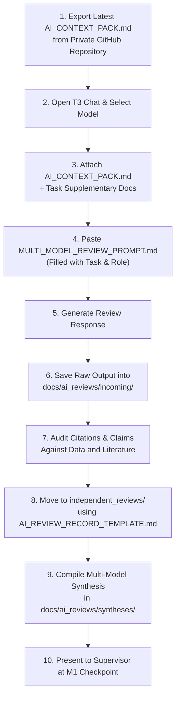

# AI Reviews Archive & Collaboration Hub

> **Archive Governance Notice:**  
> The documents preserved in this archive represent independent model review outputs, peer critiques, and structured multi-model syntheses.  
> **Crucial Rule:** An AI-generated review or synthesis archived here is strictly advisory and does **NOT** constitute an approved research decision or verified ground truth. The canonical GitHub repository documents ([CURRENT_STATE.md](../../CURRENT_STATE.md), [RESEARCH_BLUEPRINT.md](../../RESEARCH_BLUEPRINT.md), [DECISION_LOG.md](../../DECISION_LOG.md)) remain the sole official sources of truth.

---

## 1. Directory Structure & Organization

```text
docs/ai_reviews/
├── README.md                              # Archive guidelines and practical workflow (this file)
├── incoming/                              # Raw, unvetted AI model responses awaiting human review
│   └── README.md
├── independent_reviews/                   # Preserved individual model reviews categorized by role
│   ├── scientific/                        # Biological plausibility and oncological taxonomy reviews
│   ├── methodological/                    # Study design, confounding, and leakage reviews
│   ├── statistical/                       # Cross-validation, metrics, and survival statistics reviews
│   ├── literature/                        # Prior art, citation hygiene, and novelty checks
│   └── adversarial/                       # Skeptical peer reviews and failure-mode analyses
└── syntheses/                             # Cross-model comparisons and reconciliation reports
    └── README.md
```

---

## 2. Practical T3 Chat (and External AI) Execution Workflow

Because `glioma-fyp-research-hub` is a **private GitHub repository**, external AI platforms (such as T3 Chat, ChatGPT, Claude, or Gemini) **cannot automatically access or synchronize with the repository via GitHub links**.

All multi-model reviews must follow this manual, document-grounded workflow:



### Detailed Sequence:

1. **Obtain Latest Context Pack:** Download or copy [AI_CONTEXT_PACK.md](../../AI_CONTEXT_PACK.md) from the local repository (or private GitHub `main` branch). Verify the Git commit SHA matches the latest commit.
2. **Access AI Platform:** Open T3 Chat (or your preferred web/API interface for Claude, ChatGPT, Gemini, etc.).
3. **Select Model:** Choose an appropriate frontier model suited for the assigned review role (e.g., strong reasoning models for methodological/adversarial reviews).
4. **Attach Research Context:**
   - Attach or paste `AI_CONTEXT_PACK.md`.
   - Attach any specific document under review (e.g., `RESEARCH_BLUEPRINT.md` or `DATA_GOVERNANCE.md`).
   - *Never attach raw clinical datasets, raw RNA-seq matrices, or private credentials.*
5. **Dispatch Review Prompt:** Copy [MULTI_MODEL_REVIEW_PROMPT.md](../../MULTI_MODEL_REVIEW_PROMPT.md), populate the five bracketed parameters (`[REVIEW_ROLE]`, `[RESEARCH_TASK]`, etc.), and send.
6. **Save Raw Output:** Copy the full, unedited response into `docs/ai_reviews/incoming/` as `REVIEW_RAW_<ROLE>_<MODEL>_<DATE>.md`.
7. **Verify & Audit Claims:** Fact-check any literature claims or citations made by the model against PubMed/CrossRef. Mark unverified claims as `UNVERIFIED`.
8. **Archive Formatted Record:** Move the vetted review to the appropriate category under `docs/ai_reviews/independent_reviews/<category>/` using [docs/templates/AI_REVIEW_RECORD_TEMPLATE.md](../templates/AI_REVIEW_RECORD_TEMPLATE.md).
9. **Synthesize Multi-Model Feedback:** When two or more models have completed independent reviews for the same research task, compile a structured synthesis report in `docs/ai_reviews/syntheses/` using [docs/templates/AI_REVIEW_SYNTHESIS_TEMPLATE.md](../templates/AI_REVIEW_SYNTHESIS_TEMPLATE.md).
10. **Decision Gate:** Submit the synthesis to the human research team and supervisor at a scheduled checkpoint. Canonical files are updated only upon human sign-off.
