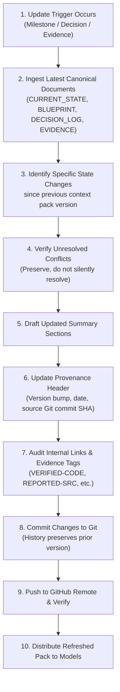

# CONTEXT_PACK_UPDATE_PROCEDURE.md — Maintenance Protocol for AI Context Pack

> **Document Status:** Operational Protocol  
> **Target Document:** [AI_CONTEXT_PACK.md](../../AI_CONTEXT_PACK.md)  
> **Authority:** `AI_CONTEXT_PACK.md` is a derived, portable summary. It is **never** an independently maintained source of truth. It must be generated strictly from canonical repository records.

---

## 1. When to Refresh `AI_CONTEXT_PACK.md`

The portable research context pack must be refreshed whenever a material change occurs in the project state, including:
1. **Milestone Completion:** A milestone (e.g., M0 Data Audit, M1 Supervisor Checkpoint) is formally closed.
2. **Methodological Decision Update:** A decision is logged, updated, or approved in [DECISION_LOG.md](../../DECISION_LOG.md).
3. **New Evidence Acceptance:** New empirical results, data audit findings, or verified literature are recorded in [EVIDENCE_REGISTER.md](../../EVIDENCE_REGISTER.md).
4. **Research Blueprint Revision:** Hypotheses or study designs in [RESEARCH_BLUEPRINT.md](../../RESEARCH_BLUEPRINT.md) are modified or approved.
5. **Major Scientific Audit:** A new independent audit or multi-model synthesis is accepted.

---

## 2. Step-by-Step Update Procedure

When an update trigger occurs, follow this 10-step sequence:

### Procedural Checklist:
1. **Verify Canonical State:** Read the latest committed versions of:
   - [CURRENT_STATE.md](../../CURRENT_STATE.md)
   - [RESEARCH_BLUEPRINT.md](../../RESEARCH_BLUEPRINT.md)
   - [DECISION_LOG.md](../../DECISION_LOG.md)
   - [EVIDENCE_REGISTER.md](../../EVIDENCE_REGISTER.md)
   - [MILESTONE_REGISTER.md](../../MILESTONE_REGISTER.md)
   - [DATA_GOVERNANCE.md](../../DATA_GOVERNANCE.md)
2. **Determine Version Increment:**
   - *Patch (1.0.x):* Minor factual corrections, link repairs, or clarifying notes.
   - *Minor (1.x.0):* Completion of a milestone (e.g., M0 audit results added) or updated decision.
   - *Major (x.0.0):* Major phase transition (e.g., moving from Phase 0 to Phase 1, or formal adoption of new grading framework).
3. **Update Provenance Header:**
   - Record new `Pack Version`.
   - Record `Generation Date`.
   - Record the latest local `Base Git Commit SHA` (from `git rev-parse HEAD`).
   - Confirm verification status against repository state.
4. **Update Section B (Current Status):** Reflect actual milestone progress without advancing gates prematurely.
5. **Update Section D (Decisions):** Explicitly separate Approved vs. Proposed vs. Pending decisions. Ensure newly resolved items reference corresponding `DEC-XXX` log IDs.
6. **Preserve Open Conflicts:** Never silently delete or "harmonize" open tensions. If a conflict remains unresolved, it must remain explicitly listed.
7. **Verify Evidence Labels:** Ensure every metric or claim retains its proper status tag (`VERIFIED-CODE`, `REPORTED-SRC`, `REPORTED`, `UNVERIFIED`, `PROPOSED`).
8. **Check File Hygiene:** Confirm zero raw data, zero patient rows, and zero credentials exist in the pack.
9. **Git Commit & Push:** Commit with message: `docs: refresh AI context pack to vX.Y.Z (Milestone/Topic)`.
10. **Verify Multi-Model Synchronization:** Notify human contributors that external AI chats (e.g., T3 Chat) must receive the refreshed context pack for subsequent review sessions.
